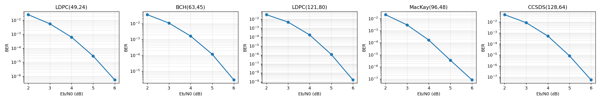
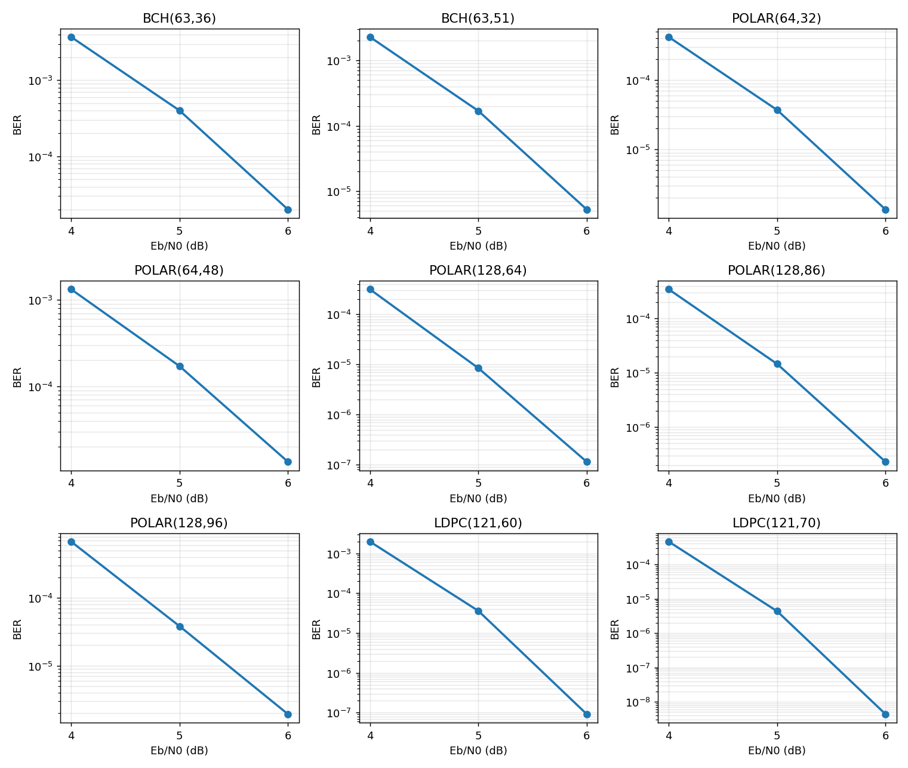
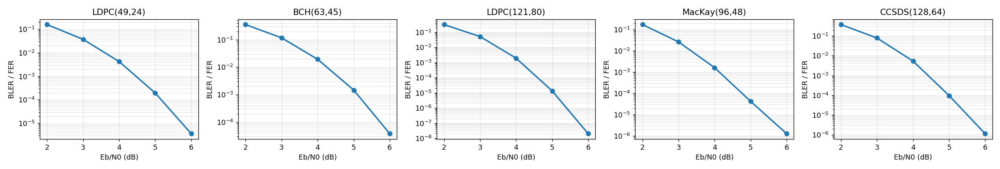
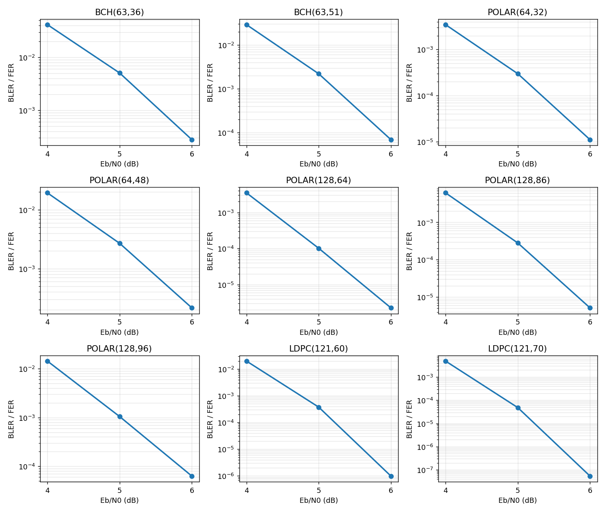

# SB-ECC Colab Reproduction

[](https://colab.research.google.com/github/baixuelin307-byte/SB-ECC-Colab-Reproduction/blob/main/SB_ECC.ipynb)

A Google Colab reproduction of **Score Based Error Correcting Code Decoder (SB-ECC)**, including training configurations, checkpoint information, evaluation logs, and BER/BLER results for **14 error-correcting codes** (BCH, Polar, LDPC, MacKay and CCSDS).

This repository documents an **independent reproduction** based on the original authors' implementation. It is **not** the official SB-ECC repository; the checkpoints and measurements presented here were produced for this reproduction.

- **Paper:** [Score Based Error Correcting Code Decoder](https://arxiv.org/abs/2605.28358)
- **Authors:** Alon Helvits and Eliya Nachmani
- **Original implementation:** [alonhelvits/SB-ECC](https://github.com/alonhelvits/SB-ECC)
- **Colab notebook:** [SB_ECC.ipynb](./SB_ECC.ipynb)
- **Checkpoints / download instructions:** [SB_ECC_Results](./SB_ECC_Results/)
- **Evaluation logs:** [test_logs](./test_logs/)

## 1. Scope

The reproduction covers the following codes over a **BPSK/AWGN** channel:

| Code | Block length `n` | Information length `k` | Code rate `k/n` | Evaluation |
| --- | ---: | ---: | ---: | --- |
| BCH(63,45) | 63 | 45 | 0.7143 | `inference.py`, 2–6 dB |
| LDPC(49,24) | 49 | 24 | 0.4898 | `inference.py`, 2–6 dB |
| LDPC(121,80) | 121 | 80 | 0.6612 | `inference.py`, 2–6 dB |
| MacKay(96,48) | 96 | 48 | 0.5000 | `inference.py`, 2–6 dB |
| CCSDS(128,64) | 128 | 64 | 0.5000 | `inference.py`, 2–6 dB |
| BCH(63,36) | 63 | 36 | 0.5714 | test at the end of training, 4–6 dB |
| BCH(63,51) | 63 | 51 | 0.8095 | test at the end of training, 4–6 dB |
| POLAR(64,32) | 64 | 32 | 0.5000 | test at the end of training, 4–6 dB |
| POLAR(64,48) | 64 | 48 | 0.7500 | test at the end of training, 4–6 dB |
| POLAR(128,64) | 128 | 64 | 0.5000 | test at the end of training, 4–6 dB |
| POLAR(128,86) | 128 | 86 | 0.6719 | test at the end of training, 4–6 dB |
| POLAR(128,96) | 128 | 96 | 0.7500 | test at the end of training, 4–6 dB |
| LDPC(121,60) | 121 | 60 | 0.4959 | test at the end of training, 4–6 dB |
| LDPC(121,70) | 121 | 70 | 0.5785 | test at the end of training, 4–6 dB |

The reproduction was done in two batches:

- **First five codes** (LDPC(49,24), BCH(63,45), LDPC(121,80), MacKay(96,48), CCSDS(128,64)): evaluated after training with `inference.py` at **Eb/N0 = 2, 3, 4, 5 and 6 dB** (`test_logs/*_paper.log`).
- **Nine additional codes** (BCH(63,36), BCH(63,51), all five Polar codes, LDPC(121,60), LDPC(121,70)): evaluated by the test that the training script runs at the end of training, at **Eb/N0 = 4, 5 and 6 dB** (`test_logs/*_final_test.log`, see Section 5).

All measurements are from the reproduction's own evaluation output, **not copied from the original paper**. The paper's numbers appear only in the comparison of Section 7.6, clearly labelled.

## 2. Repository Contents

| Path | Description |
| --- | --- |
| `SB_ECC.ipynb` | Colab workflow for setup, training, loading checkpoints, evaluation, and plotting. |
| `SB_ECC_Results/` | Checkpoint information and associated training results. |
| `test_logs/LDPC49-24_paper.log` | LDPC(49,24) evaluation output. |
| `test_logs/BCH63-45_paper.log` | BCH(63,45) evaluation output. |
| `test_logs/LDPC121-80_paper.log` | LDPC(121,80) output, including the separate 6 dB evaluation. |
| `test_logs/MACKAY96-48_paper.log` | MacKay(96,48) evaluation output. |
| `test_logs/CCSDS128-64_paper.log` | CCSDS(128,64) evaluation output. |
| `test_logs/<code>_final_test.log` | Final test of each of the nine additional codes (9 files), see Section 5. |
| `train_logs/<code>.log` | Full training logs of the nine additional codes (9 files). |
| `figures/` | BER and BLER figures of all 14 codes, drawn from the logs in `test_logs/` (Section 8). |
| `README.md` | Setup, configurations, evaluation procedure, and results. |

**Note:** The `_paper.log` suffix is only a filename convention. The logs contain **measured** results, not paper reference values. A `_final_test.log` file is the test at the end of training, cut out of the training log; for three codes it is merged with a re-test (Section 5).

## 3. Quick Start in Google Colab

1. Open the [Colab notebook](https://colab.research.google.com/github/baixuelin307-byte/SB-ECC-Colab-Reproduction/blob/main/SB_ECC.ipynb).
2. Select a GPU runtime.
3. Run the setup and installation cells.
4. Train a decoder or load a previously trained checkpoint.
5. Run evaluation and plotting to produce BER/BLER results.

Download the original implementation in a Colab cell:

```python
%cd /content
!git clone https://github.com/alonhelvits/SB-ECC.git
%cd /content/SB-ECC
!pip install -r requirements.txt
```

All paths and subsequent commands assume the working directory is `/content/SB-ECC`. The official implementation and this reproduction are separate repositories: cloning upstream does **not** automatically download this project's trained checkpoints, saved logs, or notebook modifications. Colab's `/content` storage is temporary, so back up results to persistent storage.

## 4. Training Configuration

The following settings were used for the recorded training runs:

| Parameter | Value |
| --- | --- |
| Decoder layers (`N_dec`) | 6 |
| Hidden dimension (`d_model`) | 128 |
| Attention heads (`h`) | 8 |
| Learning rate (`lr`) | 0.0005 |
| Epochs | 1500 |
| Minimum noise level (`sigma_min`) | 0.1 |
| Maximum noise level (`sigma_max`) | 0.8 |
| Solver | Euler |
| Test batch size | 2048 |
| GPU index | 0 |

**Training batch sizes:** LDPC(49,24) = 256; BCH(63,45) = 256; LDPC(121,80) = 128; **MacKay(96,48) = 256; CCSDS(128,64) = 256**. The last two values reflect the commands used in this reproduction; they should not be presented as an exact match to the paper's batch-size protocol for codes longer than 64 bits.

**The nine additional codes** were trained with the same `Main.py` and the same settings (lr 0.0005, 1500 epochs, `N_dec` 6, `d_model` 128, 8 heads, Euler, `sigma_min` 0.1, `sigma_max` 0.8, seed 42), as recorded in the `Namespace(...)` line at the top of each file in `train_logs/`. Their batch sizes follow the paper: **256** for BCH(63,36), BCH(63,51), POLAR(64,32) and POLAR(64,48) (n ≤ 64), and **128** for POLAR(128,64), POLAR(128,86), POLAR(128,96), LDPC(121,60) and LDPC(121,70). Only `--code_type`, `--code_n`, `--code_k` and `--batch_size` change from the commands below.

### LDPC(49,24)

```python
!python Main.py \
    --gpus=0 \
    --code_type=LDPC \
    --code_n=49 \
    --code_k=24 \
    --N_dec=6 \
    --d_model=128 \
    --h=8 \
    --lr=0.0005 \
    --batch_size=256 \
    --test_batch_size=2048 \
    --epochs=1500 \
    --solver=euler \
    --sigma_max=0.8 \
    --sigma_min=0.1
```

### BCH(63,45)

```python
!python Main.py \
    --gpus=0 \
    --code_type=BCH \
    --code_n=63 \
    --code_k=45 \
    --N_dec=6 \
    --d_model=128 \
    --h=8 \
    --lr=0.0005 \
    --batch_size=256 \
    --test_batch_size=2048 \
    --epochs=1500 \
    --solver=euler \
    --sigma_max=0.8 \
    --sigma_min=0.1
```

### LDPC(121,80)

```python
!python Main.py \
    --gpus=0 \
    --code_type=LDPC \
    --code_n=121 \
    --code_k=80 \
    --N_dec=6 \
    --d_model=128 \
    --h=8 \
    --lr=0.0005 \
    --batch_size=128 \
    --test_batch_size=2048 \
    --epochs=1500 \
    --solver=euler \
    --sigma_max=0.8 \
    --sigma_min=0.1
```

### MacKay(96,48)

```python
!python Main.py \
    --gpus=0 \
    --code_type=MACKAY \
    --code_n=96 \
    --code_k=48 \
    --N_dec=6 \
    --d_model=128 \
    --h=8 \
    --lr=0.0005 \
    --batch_size=256 \
    --test_batch_size=2048 \
    --epochs=1500 \
    --solver=euler \
    --sigma_max=0.8 \
    --sigma_min=0.1
```

### CCSDS(128,64)

```python
!python Main.py \
    --gpus=0 \
    --code_type=CCSDS \
    --code_n=128 \
    --code_k=64 \
    --N_dec=6 \
    --d_model=128 \
    --h=8 \
    --lr=0.0005 \
    --batch_size=256 \
    --test_batch_size=2048 \
    --epochs=1500 \
    --solver=euler \
    --sigma_max=0.8 \
    --sigma_min=0.1
```

Training results are written under `SB_ECC_Results/`, typically in timestamped code-specific directories with a checkpoint file named `best_model`.

## 5. Checkpoints and Evaluation

To evaluate without retraining, obtain the reproduced checkpoints using [SB_ECC_Results](./SB_ECC_Results/) and place them beneath `/content/SB-ECC/SB_ECC_Results/`. Confirm each printed checkpoint path before starting inference.

The two additional training runs used these checkpoint locations:

```text
/content/SB-ECC/SB_ECC_Results/MACKAY__Code_n_96_k_48__02_11_2026_11_18_45/best_model
/content/SB-ECC/SB_ECC_Results/CCSDS__Code_n_128_k_64__03_11_2026_00_56_38/best_model
```

These are **runtime paths**, not download links; verify that the files exist in the current Colab session.

### Evaluation settings

| Parameter | Value |
| --- | --- |
| Solver | Euler |
| Maximum solver steps (`num_steps`) | 10 |
| Eb/N0 | 2–6 dB in steps of 1 dB |
| Test batch size | 2048 |
| Data-loader workers | 0 |
| Random seed | 42 |

The 10-step setting is a maximum budget; syndrome-based early stopping may reduce the actual number of steps. The stopping/sample limit behavior is controlled by the particular `inference.py` used with this reproduction.

- **LDPC(49,24) and BCH(63,45):** evaluate with `--ebno_range 2,7` (upper endpoint exclusive).
- **LDPC(121,80):** evaluate with `--ebno_range 2,6` for 2–5 dB, followed by a separate 6 dB run using `--ebno_range 6 --max_samples 100000000`.
- **MacKay(96,48) and CCSDS(128,64):** evaluate 2–6 dB with `--ebno_range 2,7` and no explicit `--max_samples` in the recorded evaluation wrapper.

For example, the two additional codes can be evaluated using the reproduction's compatible inference script:

```python
!python inference.py \
    --model_path /content/SB-ECC/SB_ECC_Results/MACKAY__Code_n_96_k_48__02_11_2026_11_18_45/best_model \
    --code_type MACKAY --code_n 96 --code_k 48 \
    --solver euler --num_steps 10 --ebno_range 2,7 \
    --test_batch_size 2048 --workers 0 --gpus 0 --seed 42

!python inference.py \
    --model_path /content/SB-ECC/SB_ECC_Results/CCSDS__Code_n_128_k_64__03_11_2026_00_56_38/best_model \
    --code_type CCSDS --code_n 128 --code_k 64 \
    --solver euler --num_steps 10 --ebno_range 2,7 \
    --test_batch_size 2048 --workers 0 --gpus 0 --seed 42
```

To **save logs while streaming output**, use the notebook's Python evaluation wrapper rather than running these commands alone. The recorded filenames are:

```text
/content/SB-ECC/test_logs/LDPC49-24_paper.log
/content/SB-ECC/test_logs/BCH63-45_paper.log
/content/SB-ECC/test_logs/LDPC121-80_paper.log
/content/SB-ECC/test_logs/MACKAY96-48_paper.log
/content/SB-ECC/test_logs/CCSDS128-64_paper.log
```

The wrapper writes each model's log progressively. Re-running with `open(..., "w")` **overwrites** an existing file. Saving logs does **not** provide checkpoint-resume functionality for a partially completed evaluation.

**Compatibility note:** Some options used here may require the inference script included or adapted in the reproduction workflow. If a newly cloned upstream `inference.py` does not accept `--num_steps`, `--ebno_range`, or `--max_samples`, use the compatible notebook version before running the commands.

### Evaluation of the nine additional codes

These codes were not evaluated with `inference.py`. At the end of training (epoch 1500) the training script tests the model at 4, 5 and 6 dB, with the same Euler solver and 10 steps, until **500 frame errors** are reached or the frame limit is hit (for POLAR(128,64) at 6 dB this happened at 100,001,792 frames). The script first runs a short test and then this full test; `test_logs/<code>_final_test.log` contains the full test, copied unchanged from `train_logs/<code>.log` (the line numbers are given at the top of each file).

For three codes the Colab session disconnected during that test, so some points were measured again with a separate, resumable re-test of the **same checkpoint** (`best_model` of the same training run), Euler with 10 steps, until 500 frame errors or 1e9 frames (1e8 for POLAR(128,86)). For these codes the `_final_test.log` file is **merged**: the finished points are copied unchanged, the re-tested points are written in the same format, and the file header says which point comes from where.

| Code | From the test at the end of training | From the re-test |
| --- | --- | --- |
| POLAR(128,86) | 4 dB, 5 dB | 6 dB |
| LDPC(121,60) | 4 dB, 5 dB | 6 dB |
| LDPC(121,70) | 4 dB | 5 dB, 6 dB |

The re-test state files (`eval_state_*.json`, frame and bit error counts per solver step) are kept with the backups on Google Drive and are not part of this repository; the merged logs contain the values computed from them.

## 6. Metrics and Log Format

- **BER (Bit Error Rate):** incorrectly decoded bits divided by evaluated coded bits.
- **BLER / FER (Block/Frame Error Rate):** fraction of decoded codewords containing at least one bit error; the test code may label this metric `FER`.
- **−ln(BER):** negative natural logarithm of the BER. **Larger values mean lower BER.**

The logs contain Eb/N0-specific results and may include per-step decoder trajectories, sample counts, and run times. In `Test EbN0=..., BER=[...]`, the final entry is used as the reported BER for that SNR. Similarly, when the logs contain `BER_DDPM=[...]` or `FER_DDPM=[...]`, the final entry represents the final recorded step. The `DDPM` field names are inherited from the implementation even when the selected solver is **Euler**.

## 7. Reproduction Results

The following values are from **measured evaluation results**. They are not paper reference values; the paper's numbers appear only in Section 7.6.

The first five codes were evaluated with `inference.py` at 2–6 dB. The nine additional codes were evaluated by the test at the end of training at 4–6 dB, so their 2 and 3 dB cells are empty (–). In all tables, **†** marks a point from a re-test (Section 5) and **‡** a point with fewer than 100 erroneous codewords, which is statistically unreliable.

### 7.1 Bit Error Rate (BER) — all 14 codes

| Code | 2 dB | 3 dB | 4 dB | 5 dB | 6 dB |
| --- | ---: | ---: | ---: | ---: | ---: |
| LDPC(49,24) | 2.4567e-02 | 5.4917e-03 | 6.1336e-04 | 2.7763e-05 | 5.4468e-07 |
| BCH(63,45) | 3.5661e-02 | 1.0616e-02 | 1.6156e-03 | 1.1598e-04 | 2.8155e-06 |
| LDPC(121,80) | 3.0300e-02 | 4.5750e-03 | 1.6627e-04 | 1.0993e-06 | 1.5702e-09 ‡ |
| MacKay(96,48) | 2.0766e-02 | 2.9444e-03 | 1.6658e-04 | 3.5559e-06 | 8.3748e-08 |
| CCSDS(128,64) | 4.4201e-02 | 8.3567e-03 | 5.1576e-04 | 8.3963e-06 | 5.4921e-08 |
| BCH(63,36) | – | – | 3.6960e-03 | 3.9970e-04 | 2.0034e-05 |
| BCH(63,51) | – | – | 2.2835e-03 | 1.6892e-04 | 5.2309e-06 |
| POLAR(64,32) | – | – | 4.1972e-04 | 3.7094e-05 | 1.3578e-06 |
| POLAR(64,48) | – | – | 1.3253e-03 | 1.7133e-04 | 1.3442e-05 |
| POLAR(128,64) | – | – | 3.1565e-04 | 8.4783e-06 | 1.1484e-07 |
| POLAR(128,86) | – | – | 3.4589e-04 | 1.4563e-05 | 2.2853e-07 † |
| POLAR(128,96) | – | – | 6.7380e-04 | 3.8180e-05 | 1.9304e-06 |
| LDPC(121,60) | – | – | 1.9696e-03 | 3.5972e-05 | 9.1833e-08 † |
| LDPC(121,70) | – | – | 4.5995e-04 | 4.3369e-06 † | 4.3801e-09 † ‡ |

**Five codes evaluated with `inference.py` (2–6 dB):**



**Nine additional codes (4–6 dB):**



### 7.2 Negative log BER — paper-style reporting

The following table converts **this reproduction's BER measurements** using `−ln(BER)` and rounds the results to two decimal places.

| Code | 2 dB | 3 dB | 4 dB | 5 dB | 6 dB |
| --- | ---: | ---: | ---: | ---: | ---: |
| LDPC(49,24) | 3.71 | 5.20 | 7.40 | 10.49 | 14.42 |
| BCH(63,45) | 3.33 | 4.55 | 6.43 | 9.06 | 12.78 |
| LDPC(121,80) | 3.50 | 5.39 | 8.70 | 13.72 | 20.27 ‡ |
| MacKay(96,48) | 3.87 | 5.83 | 8.70 | 12.55 | 16.30 |
| CCSDS(128,64) | 3.12 | 4.78 | 7.57 | 11.69 | 16.72 |
| BCH(63,36) | – | – | 5.60 | 7.82 | 10.82 |
| BCH(63,51) | – | – | 6.08 | 8.69 | 12.16 |
| POLAR(64,32) | – | – | 7.78 | 10.20 | 13.51 |
| POLAR(64,48) | – | – | 6.63 | 8.67 | 11.22 |
| POLAR(128,64) | – | – | 8.06 | 11.68 | 15.98 |
| POLAR(128,86) | – | – | 7.97 | 11.14 | 15.29 † |
| POLAR(128,96) | – | – | 7.30 | 10.17 | 13.16 |
| LDPC(121,60) | – | – | 6.23 | 10.23 | 16.20 † |
| LDPC(121,70) | – | – | 7.68 | 12.35 † | 19.25 † ‡ |

The original paper's Table 1 focuses on **4, 5, and 6 dB**. The 2 and 3 dB values are additional measured points presented for completeness. This table is not a transcription of the paper's numbers.

### 7.3 Block Error Rate (BLER / FER) — all 14 codes

| Code | 2 dB | 3 dB | 4 dB | 5 dB | 6 dB |
| --- | ---: | ---: | ---: | ---: | ---: |
| LDPC(49,24) | 1.5823e-01 | 3.7199e-02 | 4.2177e-03 | 1.9423e-04 | 3.6099e-06 |
| BCH(63,45) | 3.5210e-01 | 1.1587e-01 | 1.9212e-02 | 1.4590e-03 | 3.7560e-05 |
| LDPC(121,80) | 3.1960e-01 | 5.1768e-02 | 1.9302e-03 | 1.3446e-05 | 2.0000e-08 ‡ |
| MacKay(96,48) | 1.7158e-01 | 2.6287e-02 | 1.6116e-03 | 4.2011e-05 | 1.2600e-06 |
| CCSDS(128,64) | 3.7211e-01 | 7.8215e-02 | 5.3412e-03 | 9.6998e-05 | 1.1500e-06 |
| BCH(63,36) | – | – | 4.1474e-02 | 5.0522e-03 | 2.7673e-04 |
| BCH(63,51) | – | – | 2.9028e-02 | 2.2060e-03 | 6.9576e-05 |
| POLAR(64,32) | – | – | 3.4592e-03 | 2.9869e-04 | 1.1103e-05 |
| POLAR(64,48) | – | – | 1.9392e-02 | 2.6855e-03 | 2.1421e-04 |
| POLAR(128,64) | – | – | 3.4799e-03 | 1.0158e-04 | 2.2700e-06 |
| POLAR(128,86) | – | – | 6.1384e-03 | 2.8054e-04 | 5.1463e-06 † |
| POLAR(128,96) | – | – | 1.4330e-02 | 1.0454e-03 | 6.2935e-05 |
| LDPC(121,60) | – | – | 1.9810e-02 | 3.7520e-04 | 9.8754e-07 † |
| LDPC(121,70) | – | – | 4.8637e-03 | 4.8135e-05 † | 5.4000e-08 † ‡ |

**Five codes evaluated with `inference.py` (2–6 dB):**



**Nine additional codes (4–6 dB):**



### 7.4 Sample counts at 6 dB

| Code | Evaluated codewords | Observed erroneous codewords | Source of the 6 dB point |
| --- | ---: | ---: | --- |
| LDPC(49,24) | 100,001,792 | 361 | `inference.py` |
| BCH(63,45) | 13,338,624 | 501 | `inference.py` |
| LDPC(121,80) | 100,001,792 | 2 | `inference.py` |
| MacKay(96,48) | 100,001,792 | 126 | `inference.py` |
| CCSDS(128,64) | 100,001,792 | 115 | `inference.py` |
| BCH(63,36) | 1,810,432 | 501 | test at the end of training |
| BCH(63,51) | 7,200,768 | 501 | test at the end of training |
| POLAR(64,32) | 45,121,536 | 501 | test at the end of training |
| POLAR(64,48) | 2,338,816 | 501 | test at the end of training |
| POLAR(128,64) | 100,001,792 | 227 | test at the end of training |
| POLAR(128,86) | 97,157,120 | 500 | re-test |
| POLAR(128,96) | 7,960,576 | 501 | test at the end of training |
| LDPC(121,60) | 506,306,560 | 500 | re-test |
| LDPC(121,70) | 1,000,005,632 | 54 | re-test |

The counts of erroneous codewords are FER × evaluated codewords, taken from the logs.

**Statistical limitation:** At 6 dB, the LDPC(121,80) result is based on only **two** erroneous codewords, and LDPC(121,70) on **54**. Their BER and BLER estimates therefore have substantial sampling uncertainty: both runs reached their sample cap without accumulating 500 frame errors. Fewer than 500 erroneous codewords were also observed for CCSDS(128,64) (115), MacKay(96,48) (126), POLAR(128,64) (227), LDPC(49,24) (361), which reached the sample cap as well. More independent samples would be needed for more precise estimates at these points.

### 7.5 Reproduction observations

The additional MacKay(96,48) and CCSDS(128,64) runs extend the reproduction from three to five codes, and the nine codes trained later extend it to all 14 codes of the paper's Table 1. BER decreases with increasing Eb/N0 for all 14 codes. The measured results should be compared with the original paper only after accounting for training and evaluation configuration differences; in particular, the MacKay and CCSDS runs used a training batch size of 256, and the nine additional codes were evaluated by the test at the end of training instead of `inference.py`.

### 7.6 Comparison with the paper (all 14 codes)

The paper's values are the **SB-ECC** row of Table 1 of [arXiv:2605.28358](https://arxiv.org/abs/2605.28358) (−ln(BER) at 4 / 5 / 6 dB). *Difference* = ours − paper; positive means better than the paper.

| Code | Ours 4 / 5 / 6 dB | Paper 4 / 5 / 6 dB | Difference |
| --- | --- | --- | --- |
| LDPC(49,24) | 7.40 / 10.49 / 14.42 | 7.74 / 10.88 / 14.63 | -0.34 / -0.39 / -0.21 |
| BCH(63,45) | 6.43 / 9.06 / 12.78 | 6.58 / 9.48 / 13.17 | -0.15 / -0.42 / -0.39 |
| LDPC(121,80) | 8.70 / 13.72 / 20.27 | 8.84 / 14.02 / 20.42 | -0.14 / -0.30 / -0.15 |
| MacKay(96,48) | 8.70 / 12.55 / 16.30 | 8.97 / 12.82 / 16.25 | -0.27 / -0.27 / +0.05 |
| CCSDS(128,64) | 7.57 / 11.69 / 16.72 | 8.60 / 13.43 / 19.20 | -1.03 / -1.74 / -2.48 |
| BCH(63,36) | 5.60 / 7.82 / 10.82 | 5.74 / 8.12 / 11.20 | -0.14 / -0.30 / -0.38 |
| BCH(63,51) | 6.08 / 8.69 / 12.16 | 6.19 / 8.82 / 12.45 | -0.11 / -0.13 / -0.29 |
| POLAR(64,32) | 7.78 / 10.20 / 13.51 | 7.77 / 10.30 / 13.78 | +0.01 / -0.10 / -0.27 |
| POLAR(64,48) | 6.63 / 8.67 / 11.22 | 6.63 / 8.64 / 11.27 | 0.00 / +0.03 / -0.05 |
| POLAR(128,64) | 8.06 / 11.68 / 15.98 | 9.03 / 13.13 / 16.94 | -0.97 / -1.45 / -0.96 |
| POLAR(128,86) | 7.97 / 11.14 / 15.29 | 8.03 / 11.48 / 16.10 | -0.06 / -0.34 / -0.81 |
| POLAR(128,96) | 7.30 / 10.17 / 13.16 | 7.64 / 10.32 / 13.37 | -0.34 / -0.15 / -0.21 |
| LDPC(121,60) | 6.23 / 10.23 / 16.20 | 6.33 / 10.38 / 16.38 | -0.10 / -0.15 / -0.18 |
| LDPC(121,70) | 7.68 / 12.35 / 19.25 | 7.75 / 12.69 / 19.24 | -0.07 / -0.34 / +0.01 |

- **11 of 14 codes are within ±0.5 of the paper at all three SNR points.** Over all 42 points the mean difference is -0.38 (our value is lower than the paper's in 37 of the 42 points).
- Larger gaps: CCSDS(128,64) (-1.03 / -1.74 / -2.48); POLAR(128,64) (-0.97 / -1.45 / -0.96); POLAR(128,86) (-0.06 / -0.34 / -0.81).
- These are single training runs (seed 42). Points with few erroneous codewords (LDPC(121,80) and LDPC(121,70) at 6 dB) are too imprecise for a close comparison. MacKay(96,48) and CCSDS(128,64) used batch size 256 instead of the paper's 128 (Section 4). We have not investigated the larger gaps further.

## 8. Plotting and Outputs

The figures in `figures/` were drawn in Colab directly from the logs in `test_logs/` (the last value of each `BER_DDPM` / `FER_DDPM` list, i.e. the final solver step). Each panel shows one code, named in its title, with this reproduction's measured values only.

| File | Content |
| --- | --- |
| `figures/ber_5codes.png` | BER of the five codes evaluated with `inference.py`, 2–6 dB |
| `figures/bler_5codes.png` | BLER / FER of the same five codes, 2–6 dB |
| `figures/ber_9codes.png` | BER of the nine additional codes, 4–6 dB |
| `figures/bler_9codes.png` | BLER / FER of the nine additional codes, 4–6 dB |

Only an Eb/N0 point with a valid measured result in the logs is drawn; missing evaluation records are not interpolated or invented.

## 9. Reproducibility Notes

- Training from scratch is optional if a compatible checkpoint is already available.
- At high Eb/N0, frame errors are rare, so collecting sufficient error events can require a very large number of test codewords.
- A partially written log records progress, but the inference code does **not** automatically resume from the saved sample count.
- Download or back up logs and checkpoints before a Colab runtime reset.
- The recorded evaluation seed is 42; exact reproducibility can still depend on device, software versions, and independently trained checkpoints.
- For stricter reproducibility, record the upstream commit and Python/package versions for each run.
- Keep the `Codes_DB` matrices associated with the intended code type and dimensions.
- In the merged `_final_test.log` files, sample counts that the interrupted training test never printed are written as `nan`.
- The commands above are for Colab (`!python`, `%cd`). In a terminal, use `python` and `cd`.

## 10. Acknowledgments

The SB-ECC method and original implementation are by **Alon Helvits and Eliya Nachmani**. Please credit and cite the original paper when using the method. This repository provides an independent Colab reproduction, training configurations, checkpoints, evaluation logs, and visualizations for 14 codes.

**Original source:** [alonhelvits/SB-ECC](https://github.com/alonhelvits/SB-ECC). Retain upstream copyright and license notices when redistributing their code.
